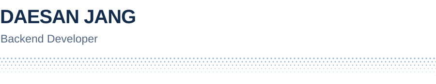
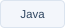
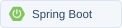
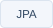
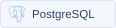
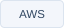
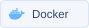
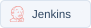
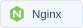

<picture>
  <source media="(prefers-color-scheme: dark) and (max-width: 600px)" srcset="./profile-assets-v7/banner-mobile-dark.svg" />
  <source media="(prefers-color-scheme: dark)" srcset="./profile-assets-v7/banner-dark.svg" />
  <source media="(max-width: 600px)" srcset="./profile-assets-v7/banner-mobile-light.svg" />
  
</picture>

<a href="mailto:diqkraud@naver.com">Email</a> &nbsp; <a href="https://velog.io/@diqkraud/posts">Velog</a>

<h2>Tech Stack</h2>

  <picture><source media="(prefers-color-scheme: dark)" srcset="./profile-assets-v7/java-dark.svg" /></picture>
  <picture><source media="(prefers-color-scheme: dark)" srcset="./profile-assets-v7/spring-boot-dark.svg" /></picture>
  <picture><source media="(prefers-color-scheme: dark)" srcset="./profile-assets-v7/jpa-dark.svg" /></picture>
  <picture><source media="(prefers-color-scheme: dark)" srcset="./profile-assets-v7/postgresql-dark.svg" /></picture>

  <picture><source media="(prefers-color-scheme: dark)" srcset="./profile-assets-v7/aws-dark.svg" /></picture>
  <picture><source media="(prefers-color-scheme: dark)" srcset="./profile-assets-v7/docker-dark.svg" /></picture>
  <picture><source media="(prefers-color-scheme: dark)" srcset="./profile-assets-v7/jenkins-dark.svg" /></picture>
  <picture><source media="(prefers-color-scheme: dark)" srcset="./profile-assets-v7/nginx-dark.svg" /></picture>

<h2>Selected Projects</h2>

<table>
  <tbody>
    <tr>
      <td width="50%" valign="top">
        <h3>패밀링크 Familink</h3>
        
<strong>백엔드 및 인프라</strong>

        
가족의 일상 공유, 일정, AI 안부 통화와 리포트를 연결한 모바일 서비스입니다.

        
그룹과 피드 API, DB 규칙을 구현하고 S3 업로드와 AWS 배포 환경을 담당했습니다.

      </td>
      <td width="50%" valign="top">
        <h3>잘타슈 JalTaShu</h3>
        
<strong>인프라</strong>

        
대전 공공자전거의 현재 현황과 도착 시점 예측을 제공하는 서비스입니다.

        
팀 모듈의 실행 환경, Blue/Green 배포, Jenkins 설정 복구와 백업 검증을 담당했습니다.

      </td>
    </tr>
  </tbody>
</table>

<h3><a href="https://github.com/daesan12/healthfit-backend">HealthFit</a> 백엔드</h3>

2인 팀으로 만든 식단과 운동 추천, 기록 및 공유 서비스입니다. 
Django REST Framework 기반 인증, 식단과 운동, 커뮤니티 API를 담당했습니다.

