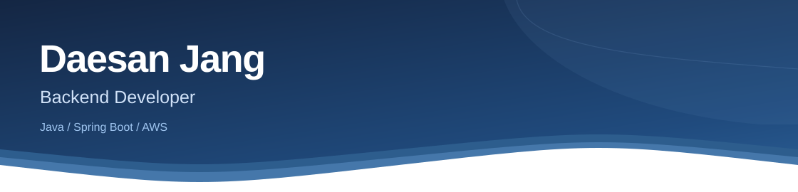
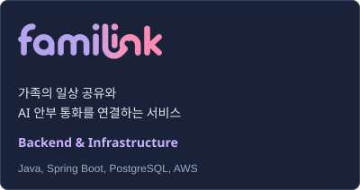
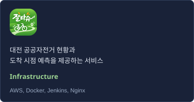

<picture>
  <source media="(max-width: 600px)" srcset="./assets/profile-v13/header-mobile.svg" />
  
</picture>

  

### Tech Stack

  <strong>Language</strong> 
  
  

  <strong>Backend</strong> 
  
  
  
  

  <strong>Database</strong> 
  
  
  
  

  <strong>Cloud / DevOps</strong> 
  
  
  
  

---

### Projects

  <picture>
    <source media="(max-width: 600px)" srcset="./assets/profile-v15/familink-mobile.svg" />
    
  </picture>
  <picture>
    <source media="(max-width: 600px)" srcset="./assets/profile-v16/jaltashu-mobile.svg" />
    
  </picture>

- **패밀링크:** 그룹과 피드 API, DB 규칙, S3 직접 업로드 API를 구현하고 AWS 운영 환경과 Jenkins 배포 절차를 구성했습니다.
- **잘타슈:** 팀 모듈의 실행 환경과 Blue/Green 배포를 구성하고, Jenkins 자격증명 복구와 MySQL 백업 및 격리 복원을 검증했습니다.

#### Other Project

**[HealthFit](https://github.com/daesan12/healthfit-backend)** — 식단과 운동 추천, 기록 및 공유 서비스  
2인 팀의 백엔드 담당으로 Django REST Framework 기반 인증, 식단, 운동과 커뮤니티 API를 구현했습니다.
