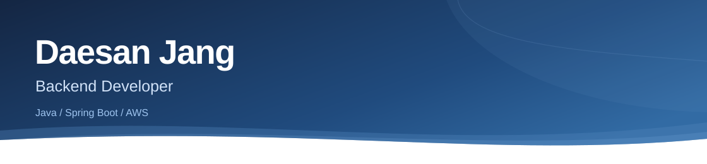

<picture>
  <source media="(max-width: 600px)" srcset="./assets/profile-v11/header-mobile.svg" />
  
</picture>

## Projects

### 패밀링크 (Familink)

백엔드 및 인프라  
가족의 일상 공유, 일정과 AI 안부 통화를 연결한 모바일 서비스입니다.

- 그룹과 피드 API, DB 규칙, S3 직접 업로드 API를 구현했습니다.
- AWS 운영 환경과 Jenkins 배포 절차를 구성했습니다.

### 잘타슈 (JalTaShu)

인프라  
대전 공공자전거의 현재 현황과 도착 시점 예측을 제공하는 서비스입니다.

- 팀 모듈의 서버 실행 환경과 Blue/Green 배포를 구성했습니다.
- Jenkins 자격증명 복구와 MySQL 백업 및 격리 복원을 검증했습니다.

### [HealthFit](https://github.com/daesan12/healthfit-backend)

백엔드, 2인 팀  
식단과 운동을 추천하고 기록을 공유하는 건강관리 서비스입니다.

- Django REST Framework로 인증, 식단, 운동과 커뮤니티 API를 구현했습니다.

## Tech stack

  <strong>Language</strong> 
  
  

  <strong>Backend</strong> 
  
  
  
  

  <strong>Database</strong> 
  
  
  
  

  <strong>Cloud / DevOps</strong> 
  
  
  
  

<!-- Technology artwork: Devicon (MIT) and Simple Icons (CC0). License files: assets/profile-v11/. JPA and SQL are text badges, not substitute product logos. -->
