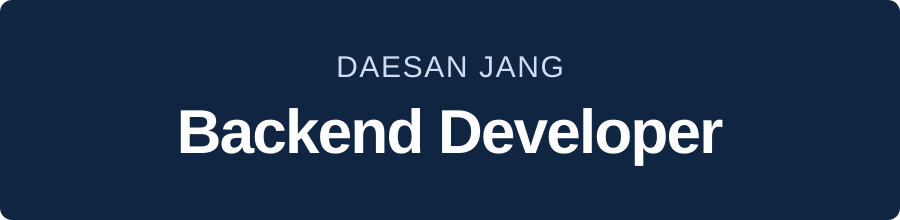
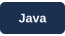

<picture>
  <source media="(max-width: 600px)" srcset="./profile-assets-v5/banner-mobile.svg" />
  
</picture>

  
  

<h2>Tech Stack</h2>

  
  
  
  
  
  
  
  

<h2>Selected Projects</h2>

<h3>패밀링크 (Familink)</h3>

  <strong>Backend &amp; Infrastructure</strong> 
  가족의 일상 공유, 일정, AI 안부 통화와 리포트를 연결한 모바일 서비스입니다. 
  그룹과 피드 API, DB 규칙, S3 업로드와 AWS 배포 환경을 담당했습니다.

<h3>잘타슈 (JalTaShu)</h3>

  <strong>Infrastructure</strong> 
  대전 공공자전거의 현재 현황과 도착 시점 예측을 제공하는 서비스입니다. 
  팀 모듈의 실행 환경, Blue/Green 배포, Jenkins 설정 복구와 백업 검증을 담당했습니다.

<h3><a href="https://github.com/daesan12/healthfit-backend">HealthFit</a></h3>

  <strong>Backend</strong> 
  2인 팀으로 식단과 운동을 추천하고 기록과 공유를 연결한 건강관리 서비스입니다. 
  Django REST Framework 기반 인증, 식단과 운동, 커뮤니티 API를 담당했습니다.

